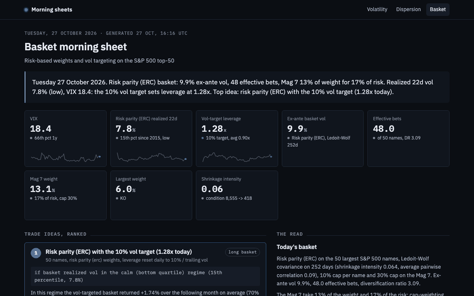

# Basket Optimizer: where does a basket's performance come from?

**Live morning sheet: [https://morning-sheet-olive.vercel.app/basket](https://morning-sheet-olive.vercel.app/basket)**, regenerated every weekday after the US close.

**Interactive app: [lonb3k-basket-optimizer.streamlit.app](https://lonb3k-basket-optimizer.streamlit.app)**, opens on the committed data, no install needed.



Streamlit app that builds risk-based baskets on the 50 largest S&P 500 names, tests six
weighting schemes walk-forward with turnover costs, adds a volatility-target overlay, and sweeps
a concentration limit on the Mag 7. The question it answers is not "which optimizer is best"
but "which decision actually moves the Sharpe": the weights, the vol target, or the cap.

Third project in the series after the [volatility dashboard](https://github.com/lonb3k/vol-dashboard)
and the [dispersion](https://github.com/lonb3k/dispersion) study, on the same universe and data.

## Survivorship, handled

Today's top 50 are the winners of the last decade: backtest any basket on them and it crushes
SPY. The backtests here run on a point-in-time universe instead. At each monthly rebalance, only
the names that were then among the 50 largest are eligible, by today's float-adjusted share count
(from the SPY holdings file) times that month's split-adjusted price; 95 different names enter the
equal-weight basket over 2015-2026. Known gaps: share counts move (buybacks, dilution) and names
delisted since cannot enter. The sidebar switches back to the fixed basket to show the bias.

| Oct 2015 to Oct 2026, net of costs | Today's top 50 | Point-in-time top 50 | SPY | RSP |
|---|---|---|---|---|
| Equal weight, annual return | 26.1% | 15.4% | 14.7% | 11.7% |
| Equal weight, Sharpe | 1.31 | 0.92 | 0.87 | 0.70 |

Ten points of return a year were survivorship. Point in time, equal weight on the largest names
roughly matched the cap-weighted index.

## Results worth defending

**1. Vol targeting moves the result more than the choice of weights.**
Six schemes (equal weight, inverse vol, min variance, risk parity, max diversification, HRP),
walk-forward since October 2015 on the point-in-time top 50, Ledoit-Wolf covariance, monthly
rebalancing, 5 bps per unit of turnover. Their Sharpe ratios span 0.81 to 0.96. A 10% vol target
on top of any of them adds about 0.2 of Sharpe and halves the worst drawdown:

| Point-in-time top 50 | Sharpe raw / vol-targeted | Max drawdown raw / vol-targeted |
|---|---|---|
| Equal weight | 0.92 / 1.06 | −32% / −16% |
| Min variance | 0.81 / 1.02 | −28% / −17% |
| Average of the six schemes | +0.20 Sharpe | −31% / −15% |

Vol clusters and spikes before the worst returns, so de-levering on rising realized vol sidesteps
part of every crash. That result survives the survivorship correction almost unchanged (on today's
names: −32% to −13%), the absolute returns do not.

**2. Weight is not risk.**
On today's universe the Mag 7 are 54% of the cap weight and 66% of the variance. Risk-based schemes
hold them at about 11% because they are the most volatile names, so a cap on Mag 7 weight binds only
below 15% and costs those schemes nothing above it. The app reports the effective number of bets
(entropy of risk contributions): about 30 for equal weight, 48 for risk parity, under 10 for cap weight.

**3. The covariance matrix is the product.**
50 names on 252 days is 1275 parameters for 252 observations. The sample matrix's condition
number runs in the thousands and an optimizer amplifies its noise into five-name portfolios.
Ledoit-Wolf shrinkage toward a constant-correlation target, with the analytical intensity,
is why min variance here holds 30 names.

**4. The option market forecasts next month's correlation better than last year does, and that helps size risk, not pick names.**
Every covariance matrix built on a trailing year assumes next month's correlation will look like
last year's. `implied_corr.py` races forecasts of next month's average pairwise correlation of the
point-in-time top 50, out of sample, monthly since 2009. Last year's average, the level built into
the sample and Ledoit-Wolf matrices, is the worst of seven (RMSE 18.0 points, correlation 0.36 with
what is realized). A regression of next month's correlation on COR1M and last quarter's correlation,
refitted each month on the previous five years only, cuts the error by a fifth (14.3 points, 0.57):
COR1M moves before a sell-off shows up in returns, and the regression strips its premium.

Moving the average correlation of the Ledoit-Wolf matrix to that forecast, with the same vols and
the same structure, cuts the QLIKE loss of the risk forecast by 15% on an equal-weight basket
(0.573 vs 0.674) and by 12% on min variance (0.591 vs 0.674). Plugging raw COR1M in without the
debiasing step gives the worst min-variance risk forecast of all (0.743). The min-variance portfolio
itself barely moves (realized vol 12.9% vs 12.8%, Sharpe 0.83 vs 0.84): its weights depend on which
names are relatively cheap in risk, not on the average correlation level. The option market tells
you how much risk you hold, not which names to hold.

## What the app shows

| Tab | Content |
|---|---|
| **Build today** | Weights for any scheme under the sidebar constraints, ex-ante vol, effective number of bets, diversification ratio, weight vs risk by name, by sector, by correlation cluster |
| **Race** | Six schemes walk-forward, net of costs, against SPY and RSP: return, vol, Sharpe, drawdown, worst month, turnover, cost drag, growth and drawdown charts, returns by year |
| **Vol targeting** | Overlay at a chosen target and max leverage, forecast from trailing realized vol or VIX-scaled, Sharpe before and after per scheme, leverage path, drawdown comparison |
| **Concentration** | Sweep of the Mag 7 weight cap: Sharpe, drawdown, worst month, effective number of bets, average Mag 7 weight |
| **Forward-looking risk** | Out-of-sample race of correlation forecasts (last year, last quarter, raw COR1M, debiased COR1M regressions), risk-forecast accuracy of five covariance matrices on equal weight and min variance (bias ratio, QLIKE, surprises), min-variance walk-forward per matrix |
| **Diagnostics** | Shrinkage intensity, condition numbers, clustered correlation heatmap |

## Decisions, and why

- **No expected returns.** Every scheme uses the covariance only. Expected-return estimates are
  where estimation error does the most damage (Michaud 1989); risk-based weights are what
  survives out of sample.
- **Walk-forward, no look-ahead.** Covariance from the trailing window ending the day before the
  rebalance; weights take effect the next day; holdings drift between rebalances and turnover
  is what it takes to get back to target.
- **Costs on every trade, including leverage changes** in the vol-target overlay. Min variance
  and max diversification turn over 20-25% a month; HRP and risk parity 7%. That difference is
  in the numbers.
- **Risk parity by optimization, HRP by recursion.** Both aim at balanced risk; HRP never
  inverts the covariance, which is why it is stable when the matrix is not.
- **Caps as constraints in the solver**, not as an after-the-fact clip, so the solution stays
  optimal under the constraint.

## Tests

```bash
.venv/bin/python -m pytest -q tests
```

Fourteen tests. The forward-looking covariance ones: the level shift hits its target, keeps the vols and stays positive definite; Ledoit-Wolf with its own sample average as external target is unchanged; tampering with every realized value from month k on leaves the forecasts up to k unchanged (no look-ahead); the risk forecast is unbiased on a stationary simulated market. The original eight: shrinkage intensity in [0, 1] with a positive-definite result; min variance matches
the closed form on two uncorrelated assets; risk parity equalizes risk contributions; caps and
group caps are respected by every solver; HRP sums to one and prefers low-vol names; effective
number of bets hits its bounds; the simulation charges full turnover on the first allocation and
small turnover after drift; the vol-target overlay delivers the target.

## Rebalance sheet

```bash
.venv/bin/python scripts/rebalance_sheet.py --method "Risk parity (ERC)" --mag7-cap 0.3
```

Prints today's weights and risk shares and the trades against the last saved sheet.


## Morning sheet

`src/basket/sheet.py` reads the dashboard for you: it runs the functions above on the
latest close and returns a desk note as a plain dict (tiles with sparklines, sentences with the
numbers filled in, trade ideas ranked by historical conditional expectation divided by the
historical worst case in the same regime, and the Plotly figures as JSON). It covers today's risk-parity weights, the vol-target leverage, the realized-vol regime, and which basket history says to hold this month, with conditional expectation and worst case.

- `python scripts/build_sheet.py [--offline]` writes `sheet/latest.json`.
- The daily GitHub Actions workflow rebuilds it after the close and commits it.
- The front end ([lonb3k/morning-sheet](https://github.com/lonb3k/morning-sheet), Next.js on Vercel)
  reads that JSON and renders it at [https://morning-sheet-olive.vercel.app/basket](https://morning-sheet-olive.vercel.app/basket), next to the sheets of the
  two sister projects. The Streamlit app stays the full interactive version.

No financial logic lives in `sheet.py`: every number comes from a function that already exists in `src/`.

## Run it

```bash
python3 -m venv .venv && .venv/bin/pip install -r requirements.txt
.venv/bin/streamlit run app.py
```

## Layout

```
app.py                     Streamlit UI
src/basket/
  universe.py              SPY holdings, sectors, Mag 7
  data.py                  prices and CBOE indices with CSV cache
  covariance.py            sample, EWMA, Ledoit-Wolf constant-correlation shrinkage (optional external target)
  implied_corr.py          COR1M-based correlation forecasts, implied-level covariance, risk-forecast tests
  optimizers.py            equal weight, inverse vol, min variance, risk parity, max diversification, HRP
  risk.py                  risk contributions, effective number of bets, clusters, tracking stats
  backtest.py              walk-forward weights, simulation with costs, vol-target overlay, stats
  charts.py                Plotly figures
scripts/rebalance_sheet.py
tests/
```

## Next

- Historical share counts, to refine the point-in-time membership (buybacks and dilution).
- A long-short extension: the dispersion book from the companion project as an overlay.
- Transaction-cost model by name (spread and ADV) instead of a flat bps.
- Use the implied-level risk forecast in the vol-target overlay, where the level of risk is exactly what matters.
